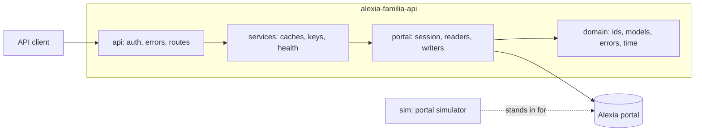
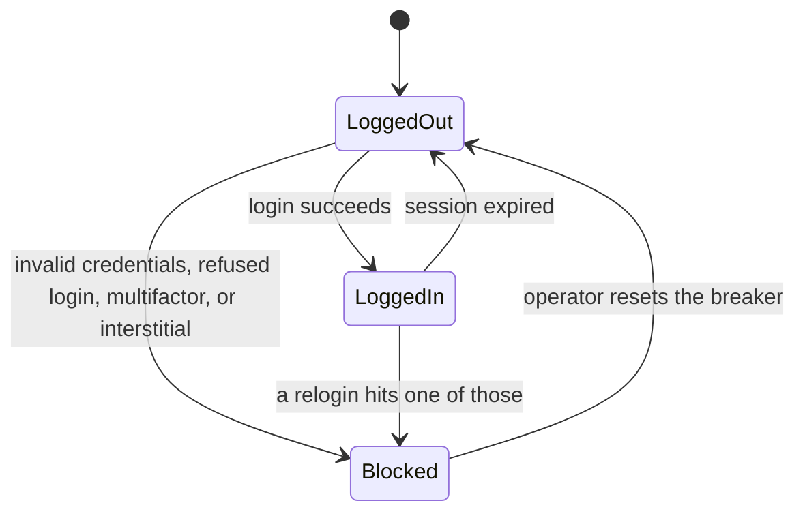
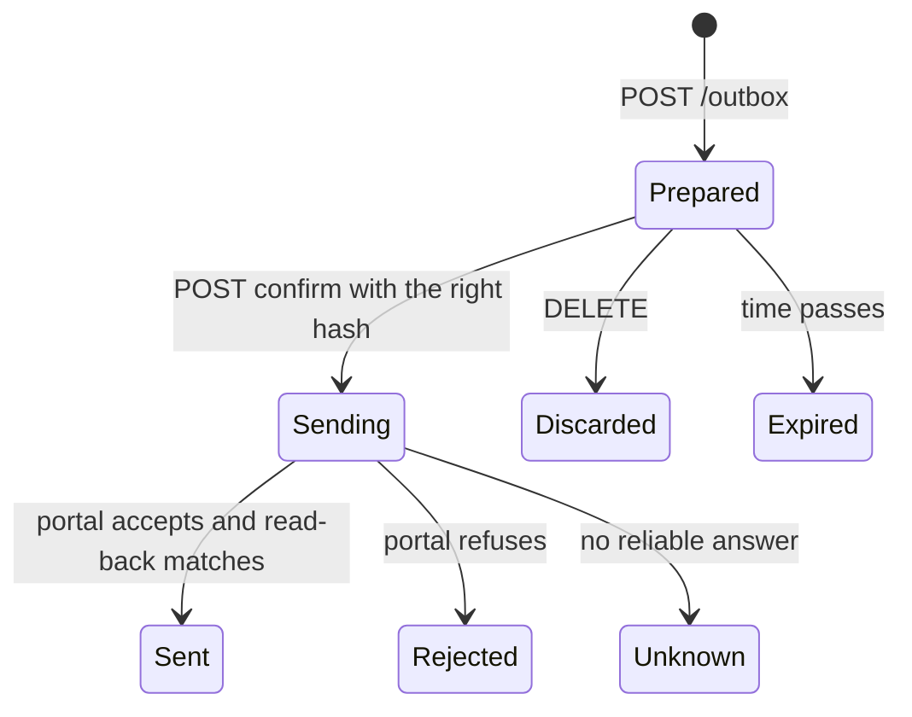

# Design

This page explains why alexia-familia-api is built the way it is. It records the choices, the alternatives that lost, and the risks the design accepts. Read it before you change how the server talks to the portal or how it handles writes.

## What this is

alexia-familia-api is a web server that you run yourself. It signs in to your Alexia Familia parent account, reads what the school publishes about your children, and serves it as a JSON REST API with an OpenAPI description. The design adds replies, meeting requests, and form answers behind switches that stay off by default. [What is built](#what-is-built) says how far the code has come.

It is for three kinds of reader.

- A parent who wants school data in Home Assistant, a spreadsheet, a calendar app, or a script.
- A developer who builds a family app and wants clean JSON instead of a WebForms portal.
- A maintainer who has to keep the server working when the portal changes.

## What is built

This page describes the whole design, and the code has not reached all of it. Each row says where a part stands, and the table changes as parts land.

| Part | State |
| --- | --- |
| The portal client, with login, session, breaker, allowlist, and politeness rules | Built |
| Readers for the children, the tracking counters, the staff, the folders, the messages, the files, the agenda, and the absences | Built |
| The REST API for those readers, with keys, scopes, rate limits, problem documents, caching, and calendar files | Built |
| The command line, the demo with a simulated school, the doctor, the Docker image, and CI | Built |
| Readers for meetings, forms, and contacts | Not built |
| Writes and the outbox | Not built. Every call in the allowlist reads, so the write settings change nothing yet |
| Putting a message back to unread | Not built |

A section below that describes a part marked "Not built" says so.

## Goals

1. A parent with no programming background can install the server, try it with synthetic data, and connect a real account.
2. One account can have several children, and one server can hold several accounts, for example both guardians.
3. Every endpoint is typed, described in OpenAPI, and tested against a simulator of the portal.
4. The server cannot hurt an account by accident. It reads by default, refuses writes unless an operator switches them on, never deletes anything, and stops logging in after a login failure.
5. The server keeps no school content on disk.

## Non-goals

- This is not an official API, and it has no connection to the makers of Alexia.
- It does not replace the school's mobile app, and it sends no push notifications.
- It does not drive a browser. The portal's own JSON services are faster and fail in fewer ways.
- It does not delete messages, manage folders, or justify absences. The portal's justify flow depends on page state that plain calls cannot follow.
- It is not a hosted service. One operator runs it for their own families.
- It does not translate or summarize. Clients can do that with the text they get.

## The portal in five facts

These facts shape every decision below. The full notes are in [protocol.md](protocol.md).

1. The portal is ASP.NET WebForms. Most data comes from JSON script services at `WS_Data/<Service>.asmx/<Method>`. The rest comes from HTML pages and from JSON grid feeds that the pages load.
2. The server side remembers state per session. The selected message folder, the open message, the open agenda, and the child page that a grid belongs to are all session state. A sequence of calls must run without another request in between.
3. A child has two identifiers. The student id (`alumno`) feeds the tracking widget, the roster, and the grids. The person id (`persona`) feeds the agenda and the photo. The guardian has a person id too.
4. A wrong password can lock the account, and several unrelated refusals look like a wrong password. An automated tool has to stop after the first login failure.
5. Some answers are not what they claim. The agenda ignores the end of the requested window. Its times carry a `Z` suffix that is not UTC. A free hour is listed once per hour, so a day with three free hours appears three times.

## Architecture

The code has four layers. Imports point down and never up. A test in `tests/test_layers.py` parses the source and fails when a layer imports one above it, when `domain` imports anything but pydantic, or when a layer other than `api` and `sim` imports the web framework. The command line, the demo, the doctor, and a few small modules are shells around the layers, and they may import any layer, but no layer may import them.

- `domain` holds the identifiers, the models, the error union, and the time rules. It does no I/O and imports no framework.
- `portal` is the only code that knows how the portal works. It owns the cookie jar, pacing, redirects, the allowlist of calls, login, the breaker, and one reader or writer per portal feature. Parsers are pure functions from text to models.
- `services` holds what a server needs and the portal does not. It owns the registry of accounts and their gateways, the per-account caches, the API keys, the rate limit, and the health report. The outbox will live here when writes arrive.
- `api` is FastAPI. It authenticates, validates, maps errors to problem documents, and calls one service method per route.
- `sim` is a fake portal. It imports nothing from `services` or `api`. Tests and the demo mode use it.

## Domain model

The model is chosen before the logic, and the type system carries the rules.

- Identifiers are distinct types. `StudentId`, `PersonId`, `StaffId`, `MessageId`, `MeetingId`, `AbsenceId`, and `FormId` are all GUID strings underneath. Passing a `PersonId` where a `StudentId` belongs is a type error, which prevents the most likely mix-up with this portal.
- Portal text becomes a model at the edge. Each reader parses once and returns frozen models. Nothing past the reader sees a Spanish field name or a raw cell.
- Failures are a closed union. `PortalErrorDetail` has one case per way the portal can fail. `describe` and the HTTP mapping use exhaustive `match`, so a new case fails type checking until both handle it.
- Connection state is a state machine, not flags. An account is `LoggedOut`, `LoggedIn`, or `Blocked`. Section [Session and breaker](#session-and-breaker) lists the transitions.
- The allowlist is data. One table lists every portal call the server may make, with its kind (read or write), its gate, and its parameter and reply schemas. The session refuses anything else.

## Accounts and children

An account is one set of portal credentials. A server holds one or more accounts. An account holds the children that the portal lists for that login.

Resources nest the way the data does.

- `/v1/accounts/{account}` is the account.
- `/v1/accounts/{account}/children/{child}/...` holds what belongs to one child. Tracking, staff, absences, and the agenda are built. Meetings are planned.
- `/v1/accounts/{account}/messages` and `/folders` belong to the guardian, and so will `/contacts` and `/forms`. The portal keeps one inbox per login, not one per child.

A `{child}` segment accepts the student id or a slug. The server derives the slug from the child's first name in lower case ASCII, adds `-2` on a collision, and lets the operator pin slugs in the configuration so URLs stay stable. A message names the children it concerns in free text. The server returns that text and the ids of the children whose names it contains.

An API key carries a set of scopes and a set of accounts. A key for the other guardian cannot read this account. Section [HTTP surface](#http-surface) lists the scopes.

The server never uses the portal's "active child" switch. Every per-child read passes the child's id in the request, and the grid and agenda readers open the child's page and read its feed in one recipe under the account lock.

## Session and breaker

Each account has one connection to the portal.

- A login failure that can lock the account moves the account to `Blocked` and the server writes that fact to the state directory. A restart keeps the block. A crash loop in a container cannot try the password again.
- Network errors, maintenance pages, and schema changes leave the state alone. They fail the request and nothing else.
- A request that finds an expired session logs in once and retries once. A second expiry fails the request.
- A session is trusted for ten minutes after its last success. After that the server probes it before use. The server sends no keep-alive pings. The portal's own page timer is client side, and measured sessions lived past forty minutes idle.
- The operator resets a block with the CLI or an admin request after fixing the cause. Fixing the cause means logging in to the portal in a browser, accepting a legal notice, or correcting the password.

## Politeness

The server is a guest on the school's system.

- One request is in flight per account. A lock serializes recipes, because the session state is shared by every request that account makes.
- At least 150 ms passes between request starts. The floor is a setting, and the default is the measured safe value.
- The User-Agent names the project and says it is a personal tool for a guardian.
- Redirects stay on the portal's origin and stop after five hops.
- Nothing runs in the background. The server talks to the portal only when a client asks, so an idle server sends no traffic.
- Reads are cached per account with short time-to-live values, and concurrent requests for the same data share one portal read. A client can ask for fresh data, and the lock and pacing still apply.

## Safety model

Reads and writes are different kinds of call.

- Every portal call is in the allowlist table. A call that is not in the table does not leave the process.
- A never-call list refuses any method whose name starts with `Borrar`, `Eliminar`, or `Delete`, and the two methods `CarpetaBorrada` and `MarcarComunicadoLeidoBadge`. A test scans the source for those names.
- Writes need three things. The operator enables the write scope in the configuration. The API key has the `write` scope. The request goes through the outbox.

### Outbox

Nothing in the code writes to the portal yet, and this is the design for when something does. A write is a two-step resource, so a script cannot send by accident and a retry cannot send twice.

- Preparing reads from the portal and writes nothing to it. The server checks that the target still exists, normalizes the content, and returns a preview with a hash of the exact content.
- Confirming must carry that hash. A changed payload has a different hash and is refused.
- The server appends a `sending` record to the write-ahead log before it calls the portal and a final record after. After a crash, an item left in `sending` becomes `Unknown`.
- An item in `Sending` or `Unknown` is never sent again. The client checks the sent folder and prepares a new item if needed.
- Confirming twice returns the first outcome.
- Form answers need a second switch. The portal's form flow was never observed on a real form, so it stays off until an operator chooses to try it.

Messages are checked after the portal saves the draft. The server reads the draft back and compares the text before it sends, and it refuses to send when the copy differs.

## HTTP surface

- The API is JSON over HTTP under `/v1`. A breaking change gets `/v2`. New fields and endpoints are not breaking.
- Dates are `YYYY-MM-DD`. Times are ISO 8601 with an offset in the configured time zone, `Europe/Madrid` by default.
- Every list is an object with an `items` array, so a field can be added later. Message lists add `total`, `limit`, `offset`, `next_offset`, and `truncated`.
- A calendar file writes a timed entry as a moment in UTC and an all-day entry as a date. It carries no time zone rules, because calendar apps disagree about how to read them. See [calendars.md](calendars.md#what-a-calendar-holds).
- Errors are RFC 9457 problem documents with a stable `code`, a `request_id`, and no stack trace.
- Responses carry `X-Request-Id`, `X-Cache`, and `Age`. Responses to authenticated routes carry `Cache-Control: no-store`.
- Authentication uses `Authorization: Bearer <key>` or `X-API-Key`. Keys are stored as SHA-256 hashes and compared in constant time.
- Scopes are `read`, `write`, `admin`, and `feed`. `admin` includes `write`, and `write` includes `read`. A `feed` key opens only the calendar feeds and may travel in a query string, because calendar apps cannot send headers.
- A client never gives the server a URL. The server calls only the base URL in the configuration, so the API has no server-side request forgery surface.

## Persistence

The state directory holds two kinds of file today.

- `breaker/<account>.json` holds the block state, a reason code, and a time. It holds no credentials.
- `api-keys.json` holds key names, scopes, accounts, and SHA-256 hashes. The CLI writes it, and the server rereads it when it changes.

A third kind arrives with writes. `outbox.jsonl` will hold one line per outbox transition with item id, kind, state, hash, and time, and no message text.

Everything else is in memory and disappears on restart. A prepared outbox item will be in memory too, so a restart discards it.

## Privacy

The server handles a child's school data, so it collects as little as it can.

- The server stores no messages, attachments, agenda, or names on disk.
- Logs hold request ids, route templates, status codes, durations, account names, key names, and the code of a failed request. They hold no child names, message text, query values, cookies, or credentials. Route templates stand in for raw paths, so a child's slug never reaches a log. An account name comes from the account that answered and not from the path, because a caller types the path, and a name with a line break in it would forge a line of the log.
- The server makes no outbound calls except to the configured portal base URLs. It has no telemetry. The optional documentation pages load Swagger UI assets from a public CDN in the browser, and a setting turns those pages off.
- The portal password is a secret string in memory. It never appears in responses, errors, logs, or OpenAPI.

## Testing

- Pure parsers and the time rules have unit tests with literal expected values.
- The simulator implements the portal's shapes for several families with several children. Tests drive the real session, gateway, and routes against it in-process.
- The simulator has fault switches for dropped responses, changed shapes, expired sessions, maintenance pages, and refused logins. Tests turn them on to check how the client fails.
- A smoke script runs the demo inside the Docker image and asks for every request that the demo suggests, over a real socket. CI runs it.
- A drift test regenerates the OpenAPI document and the endpoint reference and fails when they differ from the committed copies.
- A layer test reads every import in the package and fails when one points up. Another test fails when a source file outside the allowlist names a method that the client must never call.

The simulator and the parsers come from one author, so passing tests prove consistency and not truth. [protocol.md](protocol.md) labels every endpoint with how it was verified.

## Decisions and alternatives

| Decision | Chosen | Alternatives that lost | Why |
| --- | --- | --- | --- |
| Portal access | Plain HTTP calls to the portal's own JSON services | Headless browser, the Alexia 300 mobile API | A browser multiplies failure modes. The mobile API needs secrets extracted from the app. |
| Web framework | FastAPI | None considered | The task names it. It gives OpenAPI and validation from the same types. |
| HTTP client | httpx | aiohttp, requests in a thread pool | httpx has an in-process ASGI transport, which lets tests run the simulator without sockets. |
| HTML parser | selectolax | lxml, BeautifulSoup | It follows the HTML5 parsing rules, installs small, and selects with CSS. |
| HTML cleaner | nh3 | bleach, a hand-written filter | It is maintained and allowlist based. bleach is deprecated. |
| Package manager | pixi with conda-forge | pip with venv, uv, poetry | One tool installs Python, the libraries, the lock file, and the tasks on all three desktop systems. |
| Project install | Editable path in `pixi.toml` | `pixi-build` conda package | `pixi-build` is still a preview feature. |
| Storage | Memory, plus a breaker file, a write-ahead log, and a key file | SQLite, Redis | A mirror of school data creates a privacy duty and a sync problem. Nothing here needs more. |
| Auth | Hashed API keys with scopes | OAuth2, mTLS, no auth | Keys fit a home server. A reverse proxy can add stronger auth in front. |
| Child addressing | Nested paths with an id or slug | A `?child=` query | A path is explicit, cacheable, and works in calendar links. |
| Writes | Two-step outbox with a hash | One call with a dry-run flag | A hash binds the confirmation to the content, and the log survives a crash. |
| Cache | Per account, short time-to-live, shared reads | None, long-lived mirror | Fresh enough for a dashboard, and kind to the portal. |
| Message lists | One snapshot per folder, filtered in memory | Pass-through paging with live filters | Stable pages, any filter, and few portal calls. |
| Per-child lists | Open the child's page, then read its feed, in one recipe under the account lock | Read the feed alone | The portal's own page makes both requests in that order, with the child in both. A shortcut would lean on behavior that nobody has checked. |
| Error format | RFC 9457 problem documents | Custom JSON | Clients and tools already understand it. |
| Calendar times | UTC moments and dates, with no zone rules | A `VTIMEZONE` with `TZID` on each time, floating local times | One independent reader cut the generated zone rules short and showed summer lessons an hour off. A UTC moment reads the same in every app. |
| Session persistence | None | Sealed cookie files | A new login is cheap. The breaker file stops crash loops without storing a session. |
| Background sync | None | A polling worker | Idle servers send no traffic, and behavior is easier to predict. |

## Self-attack

These are the strongest arguments against the design and the answers.

- The school may forbid automated access. The tool reads only the guardian's own account, sends one request at a time, says what it is, and stops at the first refusal. The README tells operators to check their school's rules and to stop if asked.
- The portal can change shape. Every reader checks cell counts and field types and fails with a `portal_changed` error instead of returning wrong data. A fix is one reader and one simulator route.
- Writes were never run on a real portal, and none is built yet. When they land they will be off by default, double-gated, previewed, and labeled unverified in the docs and in the OpenAPI text.
- A memory-only design loses prepared items on restart. That costs one extra call and keeps message text off the disk.
- One process and one lock per account cap the throughput. That is on purpose, because the portal is the bottleneck and the aim is to be gentle.
- A feed key in a URL can leak. The key opens only calendar data, an operator can revoke it without touching other keys, and logs record route templates, not queries.
- The server and the simulator share an author. The simulator copies shapes from recorded behavior, and the protocol notes say which endpoints were seen on a real portal and which were not.

## Open decisions

These need an owner decision and have a default.

- License. The default is MIT.
- Package and image publishing. The default is none until a first release.
- A Spanish translation of the quickstart. The default is English only.
- Keys for one child. A key limits the accounts it opens and not the children, so a key for a calendar app opens every child of the account. The default is to keep it that way until someone needs a key for one child.
